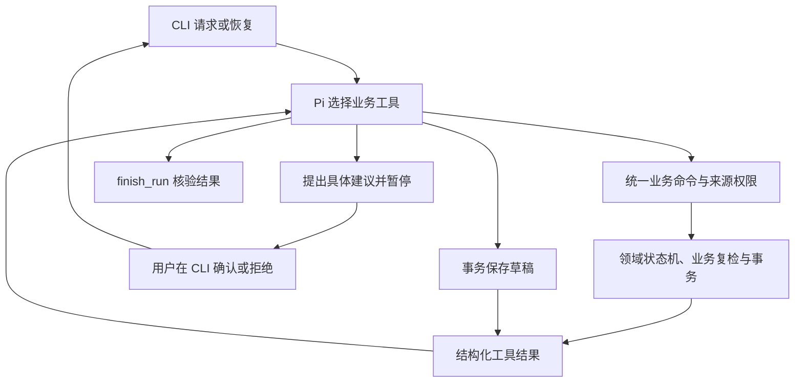

# 02 方案

## 分层与框架职责

本项目采用“Pi 编排 + Skill 操作说明 + 业务状态及写入门禁”的分层，在独立 TypeScript 项目中实现。

- `src/agent.ts`：装配 Pi AgentSession、工具、观测扩展、宿主预算和结果投影。
- `src/chat/`：模型理解业务语义、原文依据验证、业务回复投影、完整建议快照与本人确认；离线模式使用确定性理解替身。
- `PiConversationInterpreter`：每个活跃对话持有同一个 Pi AgentSession，SessionManager 保存原生消息树；实际业务回复通过 sendCustomMessage 写入模型上下文。每轮重置执行预算而不清空历史。
- `TerminalCheckpoint`：将当前业务任务、待补输入、确认卡片与原生 Pi 文件一起保存到 SQLite，按 actor 和模式恢复；用版本检查防止陈旧终端覆盖新对话。按素材查询仅定位本人已有任务，多个任务需明确选择。
- `src/http/`：POST /api/chat 的业务 DTO、SQLite 对话状态、消息幂等与按会话串行处理；不返回运行记录或内部字段。
- `src/application/scheduler.ts`：统一业务命令、类型契约与 host/agent 来源权限；CLI 和 Pi 工具共用此入口。
- `src/tools.ts`：工具定义、业务调用和执行保护，不依赖 Trace 收集或文件写入。
- `src/extensions/trace.ts`：通过 `pi.on` 订阅工具生命周期；`src/observability/trace.ts` 统一写入 JSONL。
- `src/model.ts`：Pi ModelRuntime 配置；真实 OpenAI 兼容端点与明确标注的确定性 Mock Provider。
- `src/domain/`：显式状态机、素材审核策略、时段与冲突策略、稳定指纹；策略不依赖 Pi 或数据库。
- `src/service.ts`：组合领域策略，复核确认与草稿门禁，执行事务及投影业务结果。
- `src/store.ts`：SQLite 表、事务、会话 CAS、稳定键和审计。
- `skills/content-scheduler/SKILL.md`：动作含义、公开的决策依据、风险与确认边界。

Pi 使用版本 `1.0.2`；其核心关联包也锁在 `1.0.2`，避免 caret 依赖更新导致接口漂移。使用 Session、Provider、自定义工具和原生工具循环；不自行重写 Agent 循环。`undici` 覆盖为 `8.12.2`，最终审计见实际报告。

专用 CLI 只有一个业务 Skill，宿主把它完整注入系统指令，不需要通用文件读取工具。ResourceLoader、凭据、设置和 Pi 会话显式隔离，模型仅看到七个绑定当前业务项的工具；素材正文作为数据。会话恢复通过业务状态重新装配上下文，SQLite 中没有隐藏思维或模型原始链路内容。

## 调用流程与动态决策

工具：`get_schedule_state`、`read_material`、`check_rules`、`query_slots`、`request_confirmation`、`save_schedule_draft`、`finish_run`。模型可根据当前结果选择补查、替代时间、确认、保存或阻断。工具错误也作为结构化观察回传。每次调用的 `reason` 是简短公开动作依据，不是内部思维过程。

`get_schedule_state` 返回当前 FSM、缺失字段、具体确认、真实草稿和状态历史，帮助模型理解恢复进度。状态机只限制合法迁移；既不预生成决策日志，也不规定模型必须按固定工具顺序执行。保存工具自身可以完成全部复检，不能因模型遗漏前置查询而绕过校验。

真实模式中的动作由远端模型产生。Mock 是基于消息与工具观察的固定策略，只验证同一 Pi 循环、工具协议与业务代码；不能证明真实模型决策效果。工具日志由 Pi 扩展事件实时采集，没有预生成 Trace 冒充真实运行。

## 观测与工具实现分离

ResourceLoader 禁用磁盘扩展与无关资源自动发现，通过 `extensionFactories` 显式加载观测扩展，并使用 `session.bindExtensions({mode:"print"})` 绑定生命周期。扩展只记录事实，不调用业务服务、不决定确认权限或执行预算。

| Trace 事件 | 记录入口 |
|---|---|
| run_start、run_end | 宿主 runSession，记录请求与最终结果 |
| model_request | Provider 调用边界，记录实际模型决策次数 |
| tool_start | `pi.on("tool_execution_start")`，记录 SDK callId、参数和步骤 |
| tool_end | `pi.on("tool_execution_end")`，记录结果、耗时和 SDK 异常标志 |
| tool_unfinished | `pi.on("agent_end")`，标记未配对的调用，不虚构结束结果 |
| existing_draft_revalidated 等 | 宿主幂等复检，明确区分模型工具动作 |

开始事件以 callId 放入 Map，结束事件用同一 ID 读取开始时间并清理。成功返回 JSON 的工具也可能包含业务 `ok:false`，因此 Trace 的成功标志必须同时考虑 SDK 的 isError 和实际业务结果。步骤按 SDK 尝试递增；预算仍由独立执行保护计数，被拒绝的调用有失败日志但不增加已执行计数。

正常路径示例：读素材 → 查规则 → 查时段 → 保存 → 核验结束。

冲突路径示例：读素材 → 查规则 → 观察原时段占用 → 提出替代建议 → 暂停。确认后新运行重新读资料、审核、查占用，再保存或提出新建议。保存失败路径会让模型看到失败，再决定一次重试或明确结束。

已保存项重跑使用宿主幂等快路径：业务服务重新核验规则、确认、占用，返回原草稿；Trace 标为 `existing_draft_revalidated`，不冒充模型动作。这样批次预算耗尽后，重跑可以继续剩余素材。

## 业务状态与授权

每项状态有 checking、needs_information、needs_confirmation、ready、saving、blocked、saved、save_failed、canceled。状态赋值集中于领域状态机，业务服务以事件和依据申请迁移，同时写入审计。正常保存为 ready → saving → saved；ready 尚未保存，saving 是事务内部阶段，只有真实草稿凭据才能进入 saved。整次运行另有 completed、awaiting_input、blocked、canceled、failed、incomplete。

确认必须来自 CLI，绑定 owner、素材、建议 ID/版本、素材版本、规则哈希、具体时间与确认类型。time_change 和 risk_ack 各自存一条记录；部分同意不会满足另一种要求，风险同意也不能移用到其他时段。资料变更会递增版本并使关联建议失效；规则变化通过哈希使确认失效。模型输入没有可批准的 confirmed 参数；统一入口也拒绝 agent 来源调用确认和自由资料补充命令。

保存工具不信任模型的审核结论或成功表述，在 `BEGIN IMMEDIATE` 事务中再次读取实际数据、规则、有效同意、占用，然后写草稿与审计并提交。保存失败会同时回滚草稿与成功状态历史，随后单独记录 save_failed。唯一约束和事务防止跨进程竞争。会话更新使用版本 CAS，旧快照不能覆盖新状态。

`show`/`state` 查询业务状态历史，Pi Trace 记录工具生命周期，二者职责分开。完整迁移与命令契约见 [业务契约](06-business-contract.md)，逐项操作见 [手工验收](07-acceptance-guide.md)。

## 数据与边界

SQLite 保存 materials、sessions、drafts、confirmations、audit。外部已有排期与审核规则由合成 JSON 提供，每次检查重新读取。它们用于模拟外部业务数据源，不具备和外部系统之间的跨系统事务；检查时刻之后的外部变化通过复检、查询和重跑发现。

CLI 的 actor 为本机可信输入，保护模型和业务边界，不声称提供生产登录认证。日后接 HTTP 服务时，应由认证层注入身份并收回客户端自报身份能力。

宿主在模型调用前计数，工具执行前再次计数和检查超时；默认 12 次决策、24 次工具、120 秒。finish_run 后的同批工具执行被拒绝。超限、超时或模型未完成工具闭环时返回 incomplete，保留真实已完成部分。
