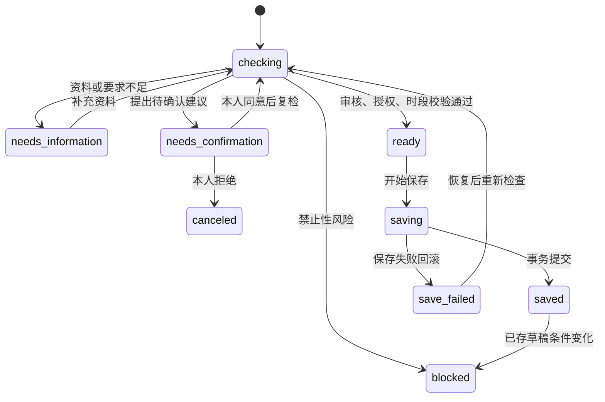

# 06 业务契约与状态机

## 业务分工

本项目只处理“素材审核与发布排期”。CLI、Pi 工具、评估入口共用 SchedulerApplication 命令注册表；命令委托 SchedulerService 完成事实校验与事务操作。审核与时段规则是独立领域策略，任务状态只能由显式状态机修改。

模型依据工具观察选择补查、替代时段、请求确认、保存或结束。状态机不返回一个预先写死的“唯一下一步”，也不替模型编排整个执行路径。

## 统一命令

| 命令 | 主要输入 | 调用来源与效果 |
|---|---|---|
| open_session | requestId、素材/渠道/时间要求 | host；按稳定键创建或恢复会话 |
| get_session / show_session | sessionId | 查询会话或交付结果，校验 owner |
| list_pending | 无 | 查询待处理素材与原因 |
| get_schedule_state | sessionId、materialId、channel | 查询 FSM、缺失项、确认、草稿与迁移历史 |
| read_material | 业务项、catalog/supplement | 查询素材；补查仅使用配置的资料源 |
| check_rules | 业务项 | 返回通过、资料不足、警告或阻断及证据 |
| query_slots | 业务项 | 查询占用与候选，必要时标记待补充要求或阻断 |
| request_confirmation | 业务项、具体 at | 创建待确认建议，不能批准 |
| save_schedule_draft | 业务项、具体 at | 统一复检门禁与事务保存；重复返回同一草稿 |
| finish_run | 业务项 | 核对已形成可交付结果，未解决状态不能宣称完成 |
| supplement_material | 业务项、fields、source | 仅 host；补充资料并使旧依据失效 |
| confirm_proposal | 业务项、建议 ID/版本、kinds、决定 | 仅 host；记录本人明确决定 |
| retry_session | sessionId | 仅 host；选择该会话中的保存失败项恢复 |

Pi 工具只能使用 agent 来源。开会话、自由补充资料、确认、主动重试入口不向模型开放；即使绕过工具声明直接提交这些命令，业务入口也拒绝 agent 来源。命令注册表拒绝未知动作，包括 publish，没有实际发布能力。

来源是可信宿主代码传入的调用上下文，不是用户 JSON 或模型可选参数。当前边界保护模型与本机 CLI 之间的权限分工；它不代替部署后的身份认证。

## 显式状态

| FSM 状态 | 含义 |
|---|---|
| checking | 需要检查或确认后的重新检查 |
| needs_information | 缺少资料，或允许范围内没有时段而需调整要求 |
| needs_confirmation | 已有具体建议，但仍需本人决定 |
| ready | 审核、授权和时段条件允许保存；尚未保存 |
| saving | 保存事务内部阶段 |
| saved | 数据库实际存在草稿 |
| save_failed | 保存失败，事务已回滚，可重试 |
| blocked | 禁止风险或已有草稿依据变化，需要人工处理 |
| canceled | 用户拒绝建议，当前业务任务终止 |

迁移表定义合法的起点与终点；进入 ready 需要校验依据，进入 saved 需要真实草稿凭据。不能从 checking 直接声明保存成功；canceled 不能恢复写入。只有领域状态机能赋值 item.status。

## 事务与恢复

保存时再次检查资料、规则、具体时段的 time_change/risk_ack 同意及冲突。通过后，在同一个 SQLite 事务中记录 ready、saving、saved 迁移，写草稿和审计。saving 是事务内部状态，不在提交前对外承诺成功。

事务失败时，草稿与成功迁移全部回滚，再单独记录 save_failed。因此失败记录不会保留假的 save_succeeded。重试复用原会话和稳定业务键，重新校验。已有草稿返回 draft_reused，只有一份实际记录。

业务状态历史保存在 audit 中，包含素材、渠道、操作者、事件、起止状态、原因与时间。show 返回会话迁移，state 返回当前业务项迁移；它们与 Pi Trace 分别记录业务事实和模型工具生命周期。

旧数据库的会话/草稿标识与原有状态仍兼容，无需清空运行数据。规则与资料的版本变化继续使旧确认失效。原始硬性要求不被建议时间覆盖。

单项恢复不会将整批未处理项判为完成：会话仍有 checking、ready 或 saving 时，整体结果为 incomplete，可用同一输入继续；已保存项复检后复用原草稿。
