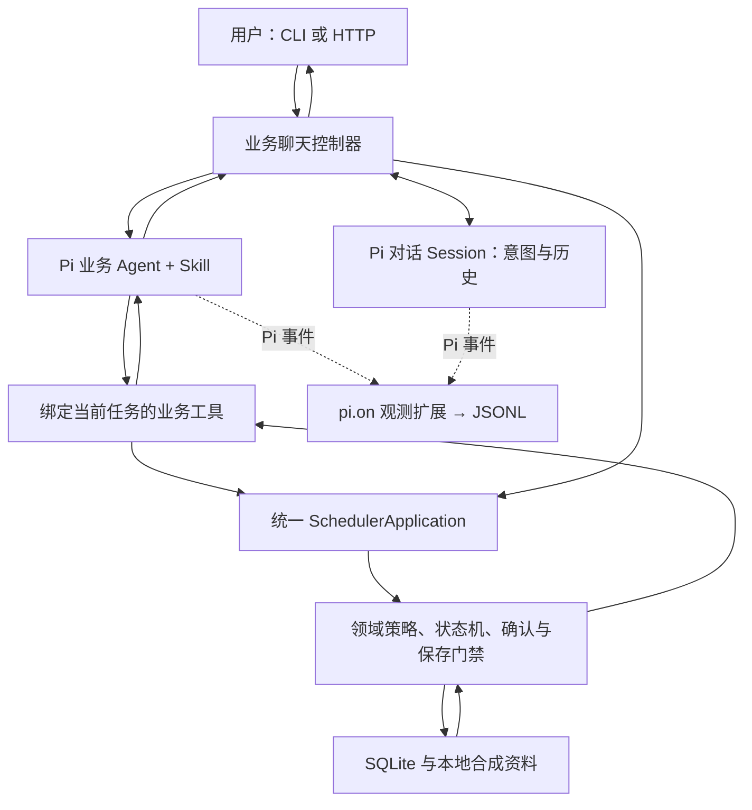

# 当前实现范围与整体架构

本项目实现的是“素材审核与发布排期草稿助手”。核心业务闭环已经实现，交付物是可核实的草稿及其审核、冲突和确认状态。没有接入真实发布。

## 核心能力

| 能力 | 当前实现 | 验证位置 |
|---|---|---|
| 找待处理素材 | 台账查询；未排期、资料不足、待确认、保存失败；按素材定位本人已有任务 | tests/chat-recovery.test.ts、tests/chat.test.ts |
| 审核与补资料 | 必填字段、授权、禁止词、警告词；记录资料来源与版本；补齐后重新审核 | tests/business.test.ts、tests/business-chat.test.ts |
| 冲突调整 | 原始要求、候选、批准时间分开；检查已有排期、草稿、批次内占用；候选调整需确认 | tests/agent.test.ts、tests/state-machine.test.ts |
| 本人确认 | 时间与风险分别记录；建议、素材、规则版本绑定；拒绝或变化后旧同意失效 | tests/application.test.ts、tests/chat.test.ts |
| 草稿保存 | SQLite 事务内重新审核及查冲突；稳定业务键、唯一约束、幂等返回、失败回滚和重试 | tests/business.test.ts、tests/application.test.ts |
| 真实 Agent 决策 | Pi 选择工具→业务执行→返回观察→模型选择下一步；12次决策、24次工具、超时/超限明确未完成 | src/agent.ts、examples/live/validation-status.json |
| 聊天与恢复 | CLI、HTTP 共用控制器；Pi 原生历史；终端逐轮检查点；HTTP 按 conversationId 恢复 | tests/chat-cli.test.ts、tests/pi-conversation.test.ts |
| 观测 | Pi 扩展通过 pi.on 订阅工具开始/结束；后台 JSONL 与业务回复分离 | tests/trace.test.ts |

六项必验（正常、资料不足、规则风险、冲突、重复、保存失败）的执行材料及边界测试见 [评估](03-evaluation.md)。Mock 验证业务流程，不证明真实模型效果。真实 Kimi 已完成一次完整11场景运行，输出、Trace及实际SQLite交叉核对通过，见 [核对报告](../examples/live/acceptance-review.json)；另有聊天、补资料和会话恢复记录。没有据此声称所有口语表达已验证或多次稳定性达标。

## 分层

Pi 负责选择动作。Skill 是注入业务 Agent 的操作说明，描述工具、确认和结束边界。业务服务负责验证模型选择是否能执行，掌握状态和事务写入权限。审核和冲突检查使用可执行策略，不能被模型一句“通过”覆盖。

有两类 Session：Pi 对话 Session 保存模型可见消息；SQLite 业务 Session 保存素材任务、原要求、审核、建议、确认和保存事实。终端检查点将当前任务、待补输入、确认卡片和 Pi 原生文件关联起来，重启后一起恢复。每次业务执行从 SQLite 当前状态重新构建工具上下文，不依赖模型记住旧的批准或保存结果。

按素材恢复只查本人任务。唯一未完成任务可以定位；多个任务必须明确原定时间和渠道。只有素材 ID、没有已有任务时，仍须提供排期要求，不会猜时间或创建空任务。

## 明确边界

- 素材台账、授权、规则与既有排期均为合成数据。审核是必填、授权状态及配置词表检查，不是图像/视频内容识别或完整内容合规判断。
- 仅保存草稿，不调用抖音、小红书等渠道发布接口，没有定时发布执行器。“已审核”“已保存”和“已发布”分别处理，系统不会产生已发布状态。
- 人工环节是本机用户本人确认，不包含多人会签、主管审批或企业审批平台。actor 为本机可信配置，未实现生产登录鉴权。
- 默认上海时间、每渠道每整点一项，时段来自规则文件。支持明确日期、今天/明天/后天及本周/下周/下下周；不自动将半点、截止时间或模糊范围改为固定整点。聊天逐项处理；批量、时间窗口使用 JSON CLI。
- 已保存草稿本期仅支持查询、幂等返回与变化检测；不自动编辑、撤销或改排已存草稿。
- 对话消息幂等、单进程 HTTP 串行、终端检查点版本保护和草稿事务已实现；没有分布式会话锁、外部排期系统事务或生产运行平台。
- 当前不自动压缩长对话。达到模型窗口、执行次数或时间限制时明确失败或未完成，保留实际业务进度。
- 自动验证中的授权陈述、同意和拒绝由测试程序输入，全部应按测试夹具解读，不能当作真人审批证据。

## 重启后手工检查

同一数据库、actor 与模式下，终端自动恢复上次对话。旧版本留下的业务任务也可通过“查看 M06”“查询待处理清单 m06”或“M06”定位；唯一未完成任务可直接“补充M06标题为双十一优惠”，然后明确回复“已授权”。只有明确授权及其他检查通过后才保存。

`npm run verify` 检查全部离线测试与记录。`npm run smoke:terminal-recovery` 使用真实模型，连续启动三个独立 CLI 进程，检查“下周一→17点→重启→查询M06→补标题→重启→已授权”，并核对同一个 Pi Session、一个业务任务和一份草稿；证据见 [验证结果](../examples/chat/live-terminal-recovery/validation.json) 与 [逐进程对话](../examples/chat/live-terminal-recovery/terminal-records.json)。
